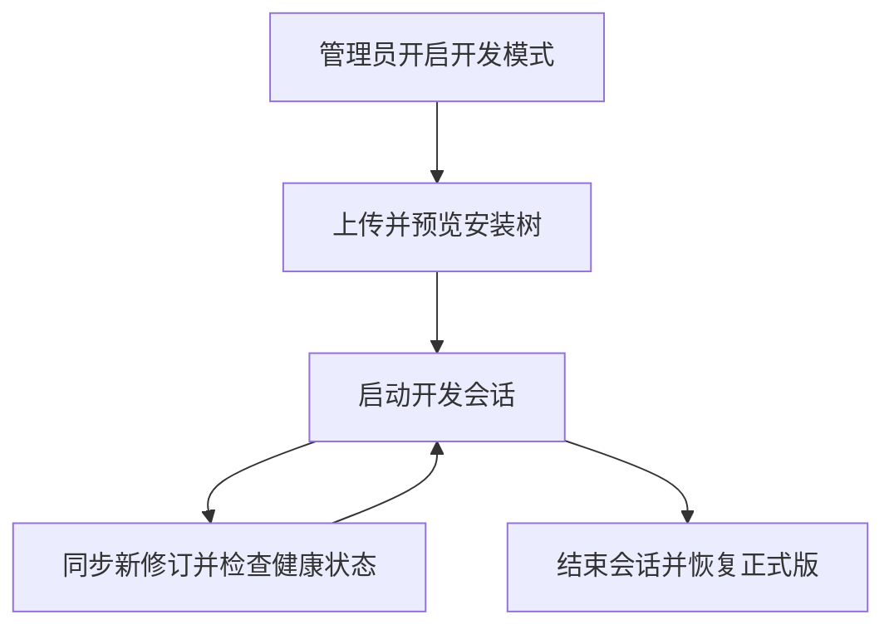

# 插件开发者模式（提案）

状态：设计草案，尚未实现。本文中的命令、接口和字段均为拟议接口。

## 支持范围

开发会话支持用户态插件的页面、命令方法、entrypoint、Controller、贡献点及已编译屏幕 App。环境包、系统插件、系统依赖与内核模块仍通过正常安装或系统升级更新。

开发模式保持普通插件的权限、设备兼容性和进程身份要求。
现有插件开发流程见[开发指南](../../onekvm-extension-example/docs/development.zh-CN.md)。



## 用户操作

入口：“设置 → 插件 → 开发者模式”，默认关闭。仅管理员可以开启、上传、
创建会话和查看开发诊断；默认只在本次设备启动期间生效，重启后关闭。
Core 或宿主进程重启时恢复本次启动内的会话，不等同于设备重启。

| 操作 | 行为 |
| --- | --- |
| 加载开发目录 | 电脑工具上传已暂存的安装目录，设备先预览 manifest、权限、架构和文件变化，再启动会话 |
| 自动同步 | 本地构建成功后上传新快照；失败或文件尚未写完时继续使用上一份 |
| 刷新页面 | 更新页面资源并加载新修订，不要求修改发布版本 |
| 重启后端 | 仅停止并启动该插件的受管进程，显示健康检查结果 |
| 调试信息 | 查看该插件的日志、manifest、权限、路由、方法、贡献点及当前修订 |
| 结束调试 | 恢复正式插件原有启用状态、设置和数据；此前未安装则移除开发注册 |
| 关闭开发者模式 | 结束全部开发会话；恢复未完成时显示失败及重试入口 |

插件列表与页面持续显示“开发中”和当前修订。新增权限、能力或外部访问入口时，
先显示变化并由管理员重新接受，再切换修订；普通文件同步不重复询问。
不自动复制正式版密码、Token 或其他秘密；开发配置由开发者填写。

## 上传与同步

接收根目录含 `manifest.json` 的已构建安装树。原生程序使用 `onekvm-distro` Make/OE 构建；屏幕 App 需通过 PocketJS ABI 校验。

拟议命令：

```sh
onekvm-ext-dev watch ./staged --device root@device
onekvm-ext-dev logs --device root@device --extension example-service
onekvm-extension dev status
onekvm-extension dev stop example-service
```

电脑工具通过 SSH 或管理员 HTTPS 会话连接。上传仅写入受管暂存区；不接受设备任意目录或远程开发服务器 URL，不执行载荷内的构建脚本。

## 存储、身份与数据

正式插件目录 `/data/onekvm/apps/<id>/<version>` 和 opkg 记录保持原样。
开发载荷位于 `/data/onekvm/development/<id>/<session>/revisions/<digest>/`；
每个修订由宿主持有、校验完成后只读发布，不直接执行仍被同步的可写目录。
开发配置与数据放在该会话的独立子目录，运行时 socket 继续由宿主管理。

同一 ID 同时只有一个有效来源：正式版本或一个开发会话。开发会话保存原始
版本、启用状态和生命周期修订；先停正式进程，再启动开发进程，不改写正式设置。
保持原插件 ID、标准 unit 命名和 systemd slice，继续使用 `SO_PEERCRED`、cgroup
及 `/run/onekvm/extension-auth/<id>.json` 验证身份，不引入调试通用 Token。

正式版安装、更新、切换版本、移除及手工启停，与同 ID 开发会话互斥；返回
`development_session_active`，先结束会话再操作。插件设置与方法调用必须绑定
当前开发会话和修订，旧页面的迟到请求不能落到恢复后的正式版本。

已结束的开发数据不混入正式备份、正常升级恢复或正式设置。界面允许导出或删除
开发数据，并显示空间占用；载荷保留当前与上一修订，未引用暂存内容按 TTL 清理。
设置开发存储总上限，空间不足在停旧版本之前报错，不能自动删除正式数据。

隔离数据不能撤销插件已经产生的外部效果，例如修改远端服务或硬件状态；结束
调试恢复的是本机运行来源和受管状态，不能宣称能回滚所有外部操作。

## 上传与切换事务

上传使用专用开发载荷（manifest 加相对文件），不交给 opkg，不带维护脚本。
沿用本地上传 32 MiB 的压缩体积上限，另限制展开体积、文件数和路径长度；数值
由 HTTP、CLI 与宿主共享。流式写入 `/data` 暂存区，避免整包及展开内容驻留内存。
拒绝绝对路径、路径穿越、重复路径、符号链接、硬链接和设备节点；检查文件大小、
执行位、架构、manifest 引用、权限、屏幕 ABI 和现有依赖。缺依赖时列出缺项，
不借开发载荷安装共享系统库或绕过 kernel magic。

每个快照有内容摘要和递增修订。上传、校验和权限确认期间，旧修订继续运行。激活前复查会话与预期修订，再依次执行：

1. 写入恢复日志，核对空间与原始运行状态，记录尚未修改载荷的阶段。
2. 停止本插件的 listener、主进程及受管子进程，撤销旧运行身份。
3. 在旧进程停止后快照开发配置和数据，持久化完成后才允许新代码访问。
4. 切换有效来源，发布新配置、身份记录及贡献点，启动并执行既有健康检查。
5. 成功后提交修订；失败则恢复旧修订、开发数据及运行状态。首次启动失败恢复正式版。

快照前失败时尚未修改旧数据，只恢复原进程及身份；不能使用未完成的数据快照
覆盖原目录。开发数据库迁移失败的恢复遵循现有安装事务的完整快照规则。

开发事务日志放在 `/data/pkg-state/extensions/development/`，记录设备 boot ID，
并纳入现有启动恢复顺序。本次启动内中断可恢复开发会话；boot ID 改变时先清理
遗留开发运行状态并恢复正式来源，不能自动重开开发模式。恢复失败只保留受影响
插件的失败状态和重试信息，不能对外报告“已恢复”或启动来源不明的进程。

关闭模式先进入 `closing` 并拒绝新变更，全部会话恢复完成后才报告 `disabled`。
系统升级准备要求先结束开发会话；不把开发载荷纳入正常插件依赖恢复计划。

## 刷新与诊断

电脑侧 watch 合并连续文件事件，每个会话仅一个上传/激活任务在途，并携带
预期修订；迟到任务返回冲突，不覆盖较新的修订。

| 修改范围 | 应用方式 |
| --- | --- |
| 仅 `web/` 页面或静态资源 | 只切换资源修订，重新加载当前插件页面，不重启插件后端 |
| 命令、entrypoint、Controller 或运行相关 manifest | 完整切换事务及健康检查 |
| 贡献点或已编译屏幕 App | 发布新的有效来源和 generation，由消费者卸载旧贡献并加载新贡献 |
| 宿主常驻加载的 `shell.js` 等脚本 | 提示刷新整个 Web 页面；当前运行时没有完整卸载契约，不承诺无缝热替换 |

manifest 的发布 `version` 不必变化，运行时新增 `source`、`development_session`、
`runtime_revision` 和 `asset_revision`。开发缓存键包含会话、修订及资源路径；
Core 资源路由核对修订并返回 `Cache-Control: no-store`。旧修订请求返回过期错误，
不能用同一个 URL 静默返回另一个版本的文件。

运行和资源修订分开记录：仅页面刷新沿用 `runtime_revision`，更新 `asset_revision`，
不递增后端进程身份；贡献点或运行来源变化必须递增生命周期 generation。
页面、路由、目录和屏幕资源按有效来源修订更新。有未保存表单时提示保存或丢弃，过期页面暂停写入。

日志按该插件的 unit/cgroup 及会话起止时间聚合 stdout/stderr、Core 归属日志和
宿主部署/回滚事件。提供有界历史、游标、断线续读、截断标记及级别过滤，不改变
全局日志等级，不默认记录方法请求、配置秘密、认证凭据或网络载荷。
方法调试器复用 `invoke` 的声明、参数和超时校验，不提供通用 root shell。

## HTTP 接口

D-Bus 签名、上传、任务和事件见[传输契约](extension-developer-transport-v1.md)。

开发 API 使用 `/api/development/extensions`，避免占用现有插件 ID 命名空间。
所有接口显式校验管理员身份，即使设备允许未登录访问常规功能也不开放开发接口；
变更请求沿用会话来源检查。SSH/root CLI 走相同宿主校验，不绕过模式状态和事务锁。

| 拟议 HTTP 接口 | 用途 |
| --- | --- |
| `GET /api/development/extensions/mode` | 模式、限制、活动会话与恢复状态 |
| `PUT /api/development/extensions/mode` | 开启或关闭本次启动的模式 |
| `POST /api/development/extensions/uploads` | 暂存并预览载荷，不执行 |
| `POST /api/development/extensions/sessions` | 用上传 token 创建会话，绑定预期正式修订及权限清单 |
| `GET /api/development/extensions/sessions/{session}` | 当前修订、方法和诊断 |
| `PUT /api/development/extensions/sessions/{session}/revision` | 使用上传 token 原子切换修订，要求匹配预期修订 |
| `POST /api/development/extensions/sessions/{session}/restart` | 重启本插件并检查健康状态 |
| `GET /api/development/extensions/sessions/{session}/events` | 有界 SSE 日志、修订及部署结果 |
| `DELETE /api/development/extensions/sessions/{session}` | 结束调试并恢复正式来源 |
| `GET /api/development/extensions/jobs/{job}` | 查询异步任务阶段、最终结果及恢复状态 |

上传 token 单次消费、短期有效并绑定请求者；SSH 本地暂存也由宿主管理。请求携带
会话与预期修订，冲突返回 409。模式关闭、权限不足、无效载荷、缺少依赖、
健康检查失败与恢复失败分别提供稳定错误码。长任务返回任务 ID，断开浏览器或
HTTP 超时不取消已开始的事务，由宿主完成提交或恢复。
