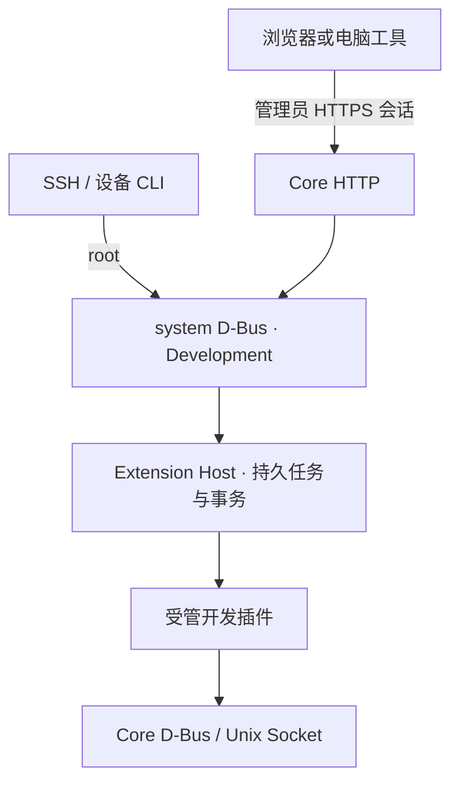

# 开发者模式的 D-Bus 与 Unix Socket 契约

状态：设计提案，尚未实现。配合[开发者模式设计](extension-developer-mode.md)阅读。

## 调用流程



Core 校验管理员会话与请求来源。Host 校验本地身份、模式、载荷、权限和事务状态。
开发插件按 manifest 能力与受管进程身份访问 Core。

## 拟议 D-Bus 接口

| 项目 | 值 |
| --- | --- |
| Bus | system bus |
| Service | `org.onekvm.ExtensionHost1` |
| Object path | `/org/onekvm/ExtensionHost1/Development` |
| Interface | `org.onekvm.ExtensionHost1.Development` |
| 调用者 | root；总线 policy 与服务端 sender UID 双重核对 |

Development 接口通过 D-Bus introspection 发现。普通插件用户和 `onekvm-extension` 组无开发管理权限。
Core 转交的 Web 用户名只用于审计，其真实性由 Core 的管理员鉴权负责。

| 方法 | 输入签名 | 输出签名 | 参数与结果 |
| --- | --- | --- | --- |
| `GetMode` | 空 | `s` | 模式、boot ID、模式 generation、容量限制与恢复状态 JSON |
| `SetMode` | `s` | `s` | 请求 JSON；开启返回状态，关闭返回持久任务 ID |
| `InspectUpload` | `hs` | `s` | 只读文件描述符、元数据 JSON；返回上传 token、摘要、manifest 和权限差异 |
| `ListSessions` | 空 | `s` | 会话摘要 JSON，不包含秘密配置 |
| `GetSession` | `s` | `s` | 会话 ID；返回修订、来源、方法、贡献点及恢复状态 |
| `StartSession` | `s` | `s` | 上传 token、预期正式修订和接受的权限摘要；返回任务 ID |
| `ApplyRevision` | `s` | `s` | 会话、上传 token 和预期修订；返回任务 ID |
| `RestartSession` | `s` | `s` | 会话、预期修订；返回重启及健康检查任务 ID |
| `StopSession` | `s` | `s` | 会话、预期修订；返回恢复正式来源的任务 ID |
| `GetJob` | `s` | `s` | 任务 ID；返回阶段、结果、错误与恢复状态 |
| `ReadEvents` | `stu` | `s` | 会话 ID、已读序号、最多条数；返回事件页及下一游标 |

`s` 为 UTF-8 JSON 字符串或表中明确标注的 ID，`h` 为 D-Bus Unix FD，`t` 为
u64，`u` 为 u32。JSON 请求必须有 `api_version: 1`，拒绝未知字段；控制 JSON
上限 64 KiB。`ReadEvents` 最多 200 条、返回上限 256 KiB，达到任一上限即分页。
JSON 中所有 u64 修订和序号使用十进制字符串，避免 JavaScript 整数精度损失。

`InspectUpload` 只接受只读、可定位的普通文件 FD，不接受设备、目录或 socket。
HTTP 或 CLI 完成上传后，以只读 FD 传递载荷。Host 将 FD 内容复制到自有暂存对象并计算摘要，
只对该副本验证和激活；源文件后续变化不能改变已预览内容。压缩载荷上限 32 MiB，
读取有期限且可中止。失败删除未引用副本，不停止原插件。

上传 token 有效期 15 分钟、只消费一次。Host 将其绑定到不可变摘要和调用主体；
Web 主体由受信 Core 桥接，SSH 主体为本地 root。权限接受项绑定摘要及预览时
的正式修订，不能用于另一个上传对象。token 不能授权管理接口，不能写入日志。

### 请求与响应示例

以下为拟议 `ApplyRevision` 的 JSON 参数：

```json
{
  "api_version": 1,
  "request_id": "c7d54c9a-3c67-4d98-9fe1-4a6a063651bf",
  "session_id": "dev-example-01",
  "expected_revision": "7",
  "upload_token": "opaque-one-use-token",
  "accepted_permissions_sha256": "sha256-of-previewed-permission-set"
}
```

接受任务时返回 `{"api_version":1,"job_id":"job-01","state":"queued"}`。
该回复表示已持久化接收，成功激活须继续读取 `GetJob` 的终态。所有变更请求
携带 `request_id`；同一主体、同一 ID 和相同参数返回同一个任务，不重复执行。
同 ID 不同参数返回冲突。会话和任务 ID 为不透明标识，调用者不得推导文件路径。

任务状态为 `queued`、`validating`、`quiescing`、`snapshotting`、`activating`、
`checking`、`rolling_back`，以及终态 `succeeded`、`failed`、`recovery_required`。
`failed` 必须说明旧版本是否已恢复；恢复不完整使用 `recovery_required`。
首次接受任务后，HTTP 超时、D-Bus 调用方消失或 SSH 断开均不取消事务。
Host 重启通过日志恢复任务；调用者以原 request ID 查询，不能盲目重试执行。

### 通知与错误

拟议信号为 `Changed(t generation)` 和 `JobChanged(s job_id, t generation)`。
信号仅为重新读取状态的提示，可合并、不保证逐条送达，不能携带 token、日志
或配置。Core 先订阅再读取初始快照，丢失 owner 或重连后重新读取；SSE 用
`ReadEvents` 回放日志，不把 D-Bus 广播当作可靠日志存储。

事件包含 `boot_id`、`session_id`、十进制 `sequence`、时间、类型和有界消息。
SSE ID 编码 boot/session/sequence；跨启动或历史已被裁剪返回 `CursorExpired`，
并给出最早可用游标。CLI 同样分页读取，慢订阅者不得阻塞切换任务。

错误名使用 `org.onekvm.ExtensionHost1.Development.Error.<Name>`：

| Name | HTTP | 语义 |
| --- | --- | --- |
| `AccessDenied` | 403 | 本地身份或 Web 管理员权限不满足 |
| `Disabled` | 409 | 模式未开启或正在关闭 |
| `Conflict` | 409 | 修订、同 ID 会话或幂等请求冲突 |
| `InvalidPayload` | 400 | 参数、载荷、架构、权限接受项或路径校验失败 |
| `PayloadTooLarge` | 413 | 载荷或展开限制超出 |
| `MissingDependency` | 422 | 系统缺少运行依赖 |
| `NotFound` | 404 | 会话、上传对象或任务不存在 |
| `CursorExpired` | 409 | 请求的事件历史不可回放 |
| `NoSpace` | 507 | 不足以完成暂存和恢复快照 |

异步执行中的健康检查或恢复失败写入任务结果的 `health_check_failed`、
`recovery_required`，不能事后伪装为接收任务时的 D-Bus 错误。未知接口/方法
保留标准 D-Bus 错误；客户端不得退回未受控的目录覆盖操作。

## Unix Socket 的角色

管理控制与 FD 传递使用 system D-Bus，不新增开发管理 Socket。
开发插件复用现有 Unix Socket，权限不因开发模式放宽：

| Socket | 协议 | 作用 |
| --- | --- | --- |
| `/run/onekvm/extension-control.sock` | HTTP/1.1，部分端点升级 WebSocket | HID、ATX、设备状态及视频设置 |
| `/run/onekvm/extension-media.sock` | 单行 JSON 握手，随后 OKVF 二进制帧或协商的共享内存传输 | 音视频、快照及显示帧 |
| `/run/onekvm/extension-crypto.sock` | 二进制握手、SCM_RIGHTS、memfd/eventfd | 有界加密服务 |
| `/run/onekvm/extension-web.sock` | 普通 HTTP/WebSocket 路由与原有登录规则 | 云端 Web 中继 |
| `$ONEKVM_EXTENSION_SOCKET/<manifest socket>` | 由插件监听的 HTTP/1.1/升级连接 | Core 将插件命名空间路由代理到其服务 |

接口以匹配的 Core/Host 版本为准。`helper.bus` 是保存 D-Bus unique name 的文本文件。

控制与媒体服务根据 `SO_PEERCRED`、systemd cgroup 和 Host 授权记录确认身份。
请求中的 ID 和 HTTP header 仅选择身份记录。正式/开发运行来源切换前停止全部
旧受管进程、撤销旧记录与连接，再发布新身份；开发来源不允许沿用旧媒体或加密
会话。仅前端资源刷新保留同一个后端和连接。Core 重启后建立新连接，不自动重放
HID、ATX、配置变更或不确定结果的加密操作。
